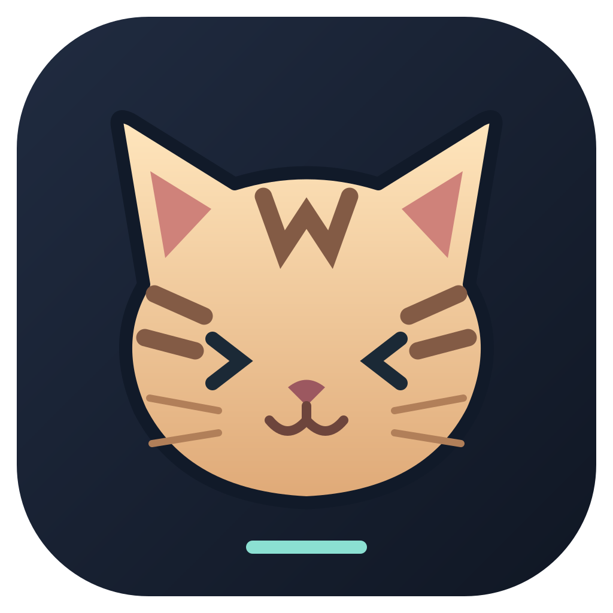

> **MeowSh** is this personal macOS fork of Paseo: full-color striped-cat branding, PDF/video/image tabs, local Open Design, draw.io, Device Simulator preview, and an agent completion chime. The logo does not change your selected theme. Automatic updates and implicit build publishing are disabled; update this build from `Waffle000/paseo`. The existing `~/.paseo` daemon home, `Paseo` desktop profile, and `paseo` pairing scheme are preserved. The application and its helpers use the distinct `sh.meowsh.desktop` bundle identity; daemon process titles are MeowSh. Old running Paseo processes retain their identity until an explicitly scheduled idle cutover. macOS may request permissions for the new identity; this build does not copy or reset privacy grants. Local simulator controls are not added to the official phone client.

> For QA, use a checkout-local `PASEO_HOME` with a separate daemon port and a distinct `PASEO_TEST_APP_NAME`. Keep the single-instance lock enabled and run only one desktop process per profile. A second process sharing that profile can fall back to memory-only browser storage while the first owns Chromium's LevelDB lock; do not diagnose lost tabs as a shutdown bug until profile ownership is checked.

> Use the pane **⋯ → Split pane right / Split pane down** menu to keep an agent and a supporting tab visible together. Each new pane has its own tab launcher; select Open Design, Device Simulator, a browser, or another supported panel there. Pane placement uses the existing saved workspace layout.

> **Open Design** appears in the local Mac workspace tab launcher and the **Design** header menu. It links the actual workspace folder, not a copied project. This integration was exercised with the official [Open Design 0.26.1 runtime](https://github.com/nexu-io/open-design/releases), installed separately at `~/.local/share/meowsh/open-design/Open Design.app`; `MEOWSH_OPEN_DESIGN_APP` can select another absolute app-bundle path. The runtime is not bundled into MeowSh. It runs on loopback with separate `open-design/` data in the desktop profile, no inherited PostHog/Langfuse telemetry keys, and a restored local browser origin. Design generation still requires a configured agent CLI supported by Open Design.

> The embedded Open Design 0.26 interface uses dark chrome, without an invert filter or modifications to design files. Generated pages remain separate preview frames with their original colors; a dark version of a design must be requested explicitly from the design agent. Open a page from **Design Files**, use **Collapse the conversation pane** to enlarge its preview, then use the **100%** zoom menu (50–200%) or the viewport selector. Same-origin blob URLs are permitted only inside subframes; top-level blob navigation remains blocked.

> **Design → Prepare design for a new agent** opens a workspace-bound composer containing the current design file references. Choose the coding model, add the implementation request, and send. **Send design context to …** sends references to an existing agent in this workspace through the normal steer path without submitting or overwriting its unsent draft. Receiving context alone does not request file changes. Other workspaces and remote-host agents are not offered as destinations; no design contents are uploaded by the handoff itself.

> iOS uses the existing `~/.local/bin/simq` queue and only its approved device. The local queue must support `app boot` and `ui prepare`/`ui stop`: connecting boots the approved device and prepares input under the held lease. Disconnect stops only the input transport started by that preview and releases the lease; it never shuts down the simulator. Blocked/paused queues require explicit human recovery. Android requires Android SDK platform-tools and an available device or AVD. Preview refresh is screenshot-based and pauses while hidden; it is not a 60-FPS video stream.

> Local macOS builds are ad-hoc signed, not notarized, and do not enable hardened runtime. Android AVDs require a complete installed system image (including `system.img`); an AVD entry alone is not sufficient to boot a preview.

> Device Simulator tabs use a private loopback endpoint saved in the desktop profile as `device-preview-endpoint.json` (mode 600). The endpoint is restored before saved browser tabs load, so reopening the desktop app preserves the tab URL. A restarted preview reconnects through the normal Connect action; it does not silently reclaim an iOS lease. Do not share the endpoint file or its capability URL.

> Open the **Usage** gauge icon at the bottom-left of the sidebar for **9router account quotas**. Each configured account has its own card, provider/plan, account label, quota percentages, used/total values, and reset countdowns. Select **Usage settings → Remaining** to read percentages like 9router's Quota Tracker. The daemon reads the same `/api/providers/client` and `/api/usage/{connectionId}` endpoints at `http://127.0.0.1:20128`, using the existing machine-local CLI authentication files under `~/.9router` only on the daemon. Refresh re-reads that account's quota endpoint and respects 9router's quota cache. Credentials never reach clients, and this integration does not reset quotas, spend credits, enable accounts, or invoke auto-ping. Shared Antigravity model budgets are grouped like Quota Tracker; unknown/unlimited limits are not presented as invented available quota. Aggregate traffic/token/cost statistics are not shown by this source.

> In the Usage list, 9router accounts are grouped by provider (Antigravity, Claude Code, OpenAI Codex, Kiro AI, etc.), across subscription plans. Each group starts collapsed and shows its visible account count; open it to see individual quotas and refresh controls. Reports marked **Unavailable** are hidden for all sources, including retained snapshots. If every report is unavailable, the list shows its normal empty state. Actual fetch errors remain visible rather than being silently suppressed. An available quota report is not hidden merely because 9router's separate account-test status says unavailable.

> In the custom desktop app, `.drawio` and `.dio` files open in a real bundled draw.io viewer/editor, including compressed and multi-page diagrams. Diagram edits and the XML Source tab share the existing file-editor buffer, autosave, modified-tab indication, and version-checked writes; use Cmd/Ctrl+S inside the diagram to save explicitly. Resolve external file changes using the existing Reload/Overwrite toolbar. The existing 1 MiB editing limit still applies; larger supported files open as a chromeless read-only diagram viewer. This does not add the editor to the official phone app.

> The first desktop build prepares draw.io **32.6.1** using `scripts/prepare-drawio.mjs`, pinned to SHA-256 `44dd56958c8408963457dc98f04d2228408ac145c7aa1d8e6895d9c88d5e42aa`. A pre-downloaded `draw.war` can be supplied via `DRAWIO_ARCHIVE`. Generated static assets are not committed; upstream Apache/asset license notices are included in the app. At runtime the editor uses an isolated local origin and opaque iframe sandbox, with external resource loads and frame navigation blocked. Diagram contents are not uploaded; remote image/font/online integrations are deliberately unavailable offline.

<p align="center">
  
</p>

<h1 align="center">MeowSh</h1>

<p align="center">
  <a href="README.md">English</a> ·
  <a href="README.zh-CN.md">简体中文</a> ·
  <a href="README.ja.md">日本語</a> ·
  <a href="README.ko.md">한국어</a>
</p>

<p align="center">
  <a href="https://github.com/getpaseo/paseo/stargazers">
    
  </a>
  <a href="https://github.com/getpaseo/paseo/releases">
    
  </a>
  <a href="https://x.com/moboudra">
    
  </a>
  <a href="https://discord.gg/jz8T2uahpH">
    
  </a>
  <a href="https://www.reddit.com/r/PaseoAI/">
    
  </a>
</p>

<p align="center">One interface for Claude Code, Codex, Copilot, OpenCode, Pi, Antigravity, and Muse Code agents.</p>

<p align="center">
  
</p>

<p align="center">
  
</p>

Paseo is an open source agentic development environment for desktop, mobile, web, and CLI. Open the desktop app and work: agents, editor, terminals, diffs, pull requests, and a browser in one window. Run many agents at once, each in its own worktree, on one machine or several. The mobile app is the full app, native on iOS and Android.

- **Parallel agents:** Run many agents at once, each in its own worktree.
- **Built-in orchestration:** Agents in Paseo can create worktrees, launch other agents, and talk to them, across providers.
- **Complete development workflow:** Edit files, review diffs, open pull requests, and run terminals, in split panes you arrange how you want.
- **Self-hosted:** Agents run on your machine with your full dev environment. Use your tools, your configs, and your skills.
- **Multi-provider:** Claude Code, Codex, Copilot, OpenCode, Pi, Antigravity, and Muse Code through the same interface. Pick the right model for each job.
- **Voice control:** Dictate tasks or talk through problems in voice mode. Hands-free when you need it.
- **Cross-device:** iOS, Android, desktop, web, and CLI. Start work at your desk, check in from your phone, script it from the terminal.
- **Privacy-first:** Paseo doesn't have any telemetry, tracking, or forced log-ins.

[Run parallel tasks in Paseo](https://paseo.sh/docs/parallel-development): start agents in separate worktrees, review their diffs, run each app, and check it in the built-in browser.

## Sponsors

<!-- Sponsors: one cell per sponsor in the order of packages/website/src/data/sponsors.ts, then "become a sponsor" cells up to three. -->
<table>
  <tr>
    <td align="center" width="33%"><a href="https://hoplite.sh/?utm_source=paseo&utm_medium=readme&utm_campaign=sponsor"><picture><source media="(prefers-color-scheme: dark)" srcset="packages/website/public/sponsors/hoplite-on-dark.svg"></picture></a><br><sub>Cloud coding agents</sub></td>
    <td align="center" width="33%"><a href="https://paseo.sh/sponsor">Become a sponsor</a></td>
    <td align="center" width="33%"><a href="https://paseo.sh/sponsor">Become a sponsor</a></td>
  </tr>
</table>

## Plugins

Plugins run on the daemon and show up in every client you connect, with the same UI on desktop, web,
iOS, and Android. Write a plugin once and it is on your phone.

- **UI:** screens, sidebar items, workspace panels, Command Center items, slash commands, composer pills, attachment sources, timeline items, themes.
- **Agent lifecycle:** change configuration, environment, and MCP servers, answer permissions, follow up when a turn ends.
- **Providers:** add a coding agent as a provider.

Install from the registry with `paseo plugin add owner/slug`, or from Git or a local directory.

**[Browse plugins](https://paseo.sh/plugins)** · **[Plugin docs](https://paseo.sh/docs/plugins)**

Plugins run with access to your daemon machine and inside connected clients; install only code you trust.

## Getting Started

Paseo runs a local server called the daemon that manages your coding agents. Clients like the desktop app, mobile app, web app, and CLI connect to it.

### Prerequisites

You need at least one agent CLI installed and configured with your credentials:

- [Claude Code](https://docs.anthropic.com/en/docs/claude-code)
- [Codex](https://github.com/openai/codex)
- [GitHub Copilot](https://github.com/features/copilot/cli/)
- [OpenCode](https://github.com/anomalyco/opencode)
- [Pi](https://pi.dev)
- [Antigravity](https://paseo.sh/docs/supported-providers#antigravity)
- [Muse Code](https://paseo.sh/docs/muse-code)

### Desktop app (recommended)

Download it from [paseo.sh/download](https://paseo.sh/download) or the [GitHub releases page](https://github.com/getpaseo/paseo/releases). Open the app and the daemon starts automatically. Nothing else to install.

To connect from your phone, open **Settings → your host → Pair Device**.

### Server

For a server, a VM, or any machine without the desktop app. Install the CLI and start the daemon:

```bash
npm install -g @getpaseo/cli
paseo
```

Paseo starts, then asks whether to enable the end-to-end encrypted relay for device pairing. If you decline, connect directly over TCP, Tailscale, or another VPN. The desktop, mobile, and web apps connect to this daemon like any other host.

For full setup and configuration, see:

- [Docs](https://paseo.sh/docs)
- [Connectivity guide](https://paseo.sh/docs/connectivity)
- [Configuration reference](https://paseo.sh/docs/configuration)

### Docker

Run the Paseo daemon and self-hosted web UI in Docker:

```bash
docker run -d --name paseo \
  -p 6767:6767 \
  -e PASEO_PASSWORD=change-me \
  -v "$PWD/paseo-home:/home/paseo" \
  -v "$PWD:/workspace" \
  ghcr.io/getpaseo/paseo:latest
```

Open `http://localhost:6767` after it starts. Extend the base image with the agent CLIs you use, then provide credentials through environment variables or the persistent `/home/paseo` volume. See the [Docker documentation](docs/docker.md) for full setup details.

## CLI

Everything you can do in the app, you can do from the terminal.

```bash
paseo run --provider claude/opus-4.6 "implement user authentication"
paseo run --provider codex/gpt-5.5 --worktree feature-x "implement feature X"

paseo ls                           # list running agents
paseo attach abc123                # stream live output
paseo send abc123 "also add tests" # follow-up task

# run on a remote daemon; --cwd is a path on that host
paseo run --host workstation.local:6767 --cwd /workspace "run the full test suite"
```

See the [full CLI reference](https://paseo.sh/docs/cli) for more.

## TypeScript SDK

Build issue integrations, dashboards, and orchestration services with `@getpaseo/client`:

```ts
import { createPaseoClient } from "@getpaseo/client";

const client = createPaseoClient({ url: "ws://127.0.0.1:6767/ws" });
await client.connect();

const agent = await client.agents.create({
  config: { provider: "codex/gpt-5.5" },
  cwd: "/Users/me/dev/storefront",
  prompt: "Review the current diff and name the riskiest change.",
});

const result = await agent.waitForFinish();
console.log(result.lastMessage);

await client.close();
```

See the [SDK quickstart](https://paseo.sh/docs/sdk/quickstart), [recipes](https://paseo.sh/docs/sdk/recipes), and [API reference](https://paseo.sh/docs/sdk/reference).

## Skills

Skills teach your agent to use Paseo to orchestrate other agents.

```bash
npx skills add getpaseo/paseo
```

Then use them in any agent conversation:

- `/paseo-handoff` — hand off work between agents. I use this to plan with Claude and then handoff to Codex to implement.
- `/paseo-advisor` — spin up a single agent as an advisor for a second opinion, without delegating the work itself.
- `/paseo-committee` — form a committee of two contrasting agents to step back, do root cause analysis, and produce a plan.

## Development

Quick monorepo package map:

- `packages/server`: Paseo daemon (agent process orchestration, WebSocket API, MCP server)
- `packages/app`: Expo client (iOS, Android, web)
- `packages/cli`: `paseo` CLI for daemon and agent workflows
- `packages/desktop`: Electron desktop app
- `packages/relay`: Relay transport and encryption used by the daemon and clients
- `packages/website`: Marketing site and documentation (`paseo.sh`)

Common commands:

```bash
# run all local dev services
npm run dev

# run individual surfaces
npm run dev:server
npm run dev:app
npm run dev:desktop
npm run dev:website

# build the server stack
npm run build:server

# repo-wide checks
npm run typecheck
```

## Support Paseo

Paseo is an independent project used by tens of thousands of developers daily, built by one person and funded by the people who use it. Support the work on [GitHub Sponsors](https://github.com/sponsors/boudra). Companies can [sponsor Paseo](https://paseo.sh/sponsor#spot) monthly and have their logo shown at the top of this README and on the paseo.sh homepage and docs.

## Related projects

- [getpaseo/paseo-relay](https://github.com/getpaseo/paseo-relay) — official distributed relay, written in Elixir
- [paseo-vscode](https://marketplace.visualstudio.com/items?itemName=hinnes.paseo-vscode) — VS Code extension

## License

Apache-2.0
